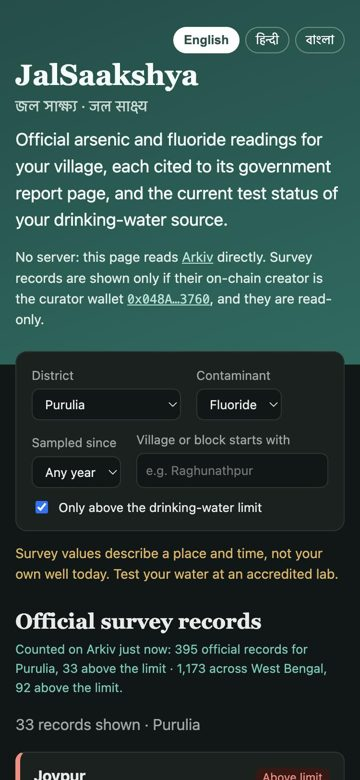
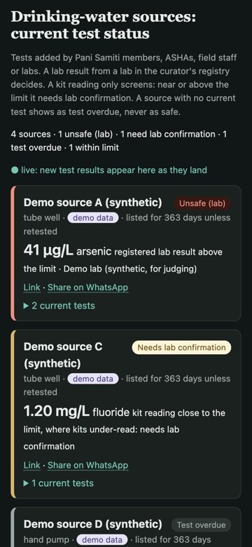
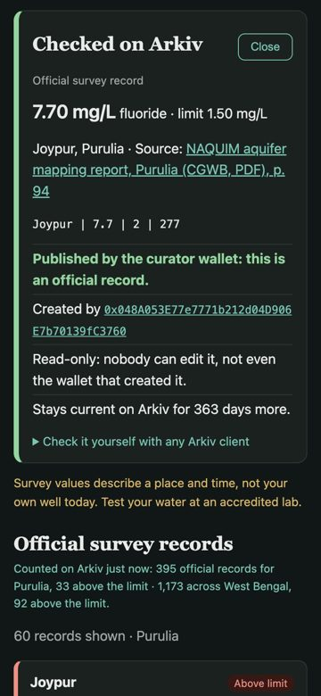
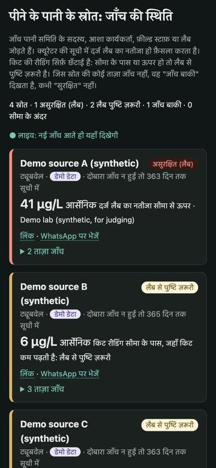

# JalSaakshya · জল সাক্ষ্য · जल साक्ष्य

**Live app:** https://mohitt31.github.io/jalsaakshya/ (English, हिन्दी, বাংলা; works on a phone) · **Demo video:** https://youtu.be/Ft-rx4UmQiE (2:51; copy in [media/](media/jalsaakshya-demo.mp4))

<p>




</p>

JalSaakshya ("water evidence") has two parts:

1. **Official survey records.** It shows groundwater arsenic and fluoride readings for West Bengal villages. Each reading cites the page of the government report it came from.
2. **Drinking-water sources.** It shows the current test status of each source, based on tests added by field-kit testers and labs. In Nadia it sits under WB PHED's own official arsenic figures for each block: 124,297 tests, 76,665 (61.7%) beyond 10 µg/L.

Everything is stored on [Arkiv](https://arkiv.network), the Web3 database, and the page reads it from the browser. There is no backend.

Built for *Arkiv: Global Tour Stop* (9 to 18 October 2026), track **Best Indian Use Case**. Answers to the submission form, judge steps and disclosures are in [SUBMISSION.md](SUBMISSION.md).

## The problem

Under Jal Jeevan Mission, five women in every village are trained to test drinking water with field test kits (FTKs). As of 2024-25 that is 24.64 lakh women ([PIB, Oct 2024](https://static.pib.gov.in/WriteReadData/specificdocs/documents/2024/oct/doc2024107410701.pdf)). Two things get in their way:

- **Official numbers are hard to reach.** The Central Ground Water Board (CGWB) publishes arsenic and fluoride measurements, but they are in annexure tables on page 100+ of PDFs that are 200 pages long. Links break when sites are reorganised: one report used here already lives under `cgwb.gov.in/old_website/`. A number forwarded on WhatsApp cannot be checked against its source.
- **A kit reading is not a verdict, but it gets treated like one.** Kits under-read close to the limit. In published evaluations, kits read wells at 10-27 µg/L arsenic as safe (George et al. 2012). They also read 21% of wells above 50 µg/L as safe (van Geen et al. 2005). The rules say kit positives must go to a lab (UDWQMP 5.1.1) and every source needs a chemical test every year (NRDWP/JJM). In practice, an old "safe" result often stays in use long after it is current.

## Who uses it, and what they get

| Who | What JalSaakshya gives them |
|---|---|
| Jal Jeevan Mission FTK testers (Pani Samiti / VWSC members, ASHAs) | Record a kit reading against a named source from a phone, in Hindi or Bengali. The app says straight away whether the reading needs a lab. |
| PHED block staff and NGO arsenic-mitigation workers | A list of sources sorted by urgency: *unsafe (lab)*, *needs lab confirmation*, *test overdue*, *within limit*. |
| Gram panchayat members, teachers, local journalists | The official survey value for their block, with the report page it came from, and proof that it was published by the curator and not edited since. |

## What it does

- **Official records.** Pick a district, a contaminant, "only above the limit", a year and a village prefix. Each card shows:
  - the measured value (arsenic in µg/L, fluoride in mg/L) and the IS 10500 limit;
  - the report title, a link to the exact PDF page, and the table row as printed.

  1,173 records from 13 documents across 21 districts are on Arkiv. 92 of them are above the limit.
- **Trust from `$creator`.** One curator wallet published those records as read-only Arkiv entities. The app shows a record as official only if its on-chain `$creator` is that wallet. The lab registry is trusted the same way, so only the curator can make a wallet count as a lab.
- **Drinking-water sources and tests.** Anyone can add a test from the app. A source's status comes from rules in [`web/src/model.ts`](web/src/model.ts) (unit-tested):
  - The latest result from a registered lab decides.
  - A kit reading only screens. If it is at or above half the limit, the source shows *needs lab confirmation*.
  - With no current test, the source shows *test overdue*. It never falls back to an old "safe".
- **Lifetimes that follow the mandates.**

  | Item | Stays current for |
  |---|---|
  | Lab result | 365 days (annual chemical test) |
  | Kit reading | 90 days (screening) |
  | Source | 365 days after its latest test; each new test renews it |
- **Share a verifiable link.** Every record and every source has *Share on WhatsApp*. The message carries a link with the Arkiv entity key. Whoever opens it gets a *Checked on Arkiv* panel, read from the chain, showing:
  - who created the entity (curator, registered lab, or a tester's own wallet);
  - whether it is read-only;
  - how long it stays current.

  A forwarded number becomes one anyone can check.
- **Official WB PHED figures (real, Nadia).** WB PHED's public Nadia Water Quality Dashboard gives arsenic tests per block, but not each source's latest result or its date ([what is public](data/phed/README.md)). The curator published the 18 block figures as read-only `blockstat` entities citing the report and its hash. They expire a year after the day they were read.
- **Visit list for block staff.** One WhatsApp message lists every source in the district that is unsafe, needs lab confirmation or is overdue, each with its check link.
- **Works offline.** The site installs as an app and opens without network. A test entered offline waits on the phone, is clearly marked "not on Arkiv yet", and is signed and sent when the network returns. Its lifetime counts from when it was taken.
- **Sealed.** `readonly` stops edits, but an owner can still delete. So the same transaction that creates a test hands its ownership to `0x…dEaD`, an address nobody holds a key for, and the curator sealed all 1,204 official records the same way. Nobody, the lab, the tester or us, can withdraw an "unsafe" result or an official record; it leaves Arkiv only when its lifetime ends. The *Checked on Arkiv* panel shows the owner.
- **Read aloud.** A 🔊 button reads a source's status and reason, and the "needs a lab" warning, in Hindi, Bengali or English (the phone's own text-to-speech).
- **Live.** New tests appear over a WebSocket subscription without reloading the page.
- **Languages.** The whole interface is in English, Hindi and Bengali, including statuses, reasons and district names.

## Why Arkiv

| Need | What breaks elsewhere | What Arkiv gives |
|---|---|---|
| Proof that a value came from the curated dataset and has not been changed | In Postgres or our own API, whoever runs the server can edit a row and nobody can tell | `$creator` is immutable and the entities are `readonly`; the app reads them with `createdBy(curator)` |
| A tester's reading must stay theirs | A central database admin can delete or rewrite an inconvenient "unsafe" | Each test is a read-only entity signed by the tester's wallet, and sealed in the same transaction (ownership to `0x…dEaD`): nobody can edit or delete it, including the lab and us |
| Old results must stop counting | A database keeps a three-year-old "safe" unless someone writes a cleanup job | Entity Expiration per type (lab 365 d, kit 90 d), and Lifetime Extension: a source stays listed while people keep testing it |
| The data must outlive this website | A dead site or a moved PDF takes the evidence with it | Anyone can query `app = "jalsaakshya/v1"` from any client, with the documented [data contract](arkiv/schema.md) |
| Filtering by place, contaminant and value | IPFS or a blob store needs a separate index; a subgraph needs our contracts and an indexer | Typed attributes with numeric ranges (`mgl > 1.5`, `year >= 2015`) and `startsWith` on place |

What stays off Arkiv on purpose:
- the PDFs (only URL, page and row text go on chain);
- the table extraction pipeline;
- translations;
- anything personal (the form refuses phone numbers and emails).

## How the data was built

The rows come from [NeerTathya](https://github.com/mohitt31/jaldrishti) (same author, built for an earlier hackathon). NeerTathya found the reports with SerpApi, read the tables and re-found every number on its PDF page. JalSaakshya reuses NeerTathya's published evidence snapshot, `data/source/neertathya-evidence.json.gz` (commit `b43d03f`). It keeps only page-verified concentration rows that have a district and a unit printed on the cited page. Rows whose unit is not printed on the page (1,386) are dropped, not guessed.

```bash
python3 scripts/build_records.py      # -> web/public/data/records.json (the curator's publish input)
python3 scripts/build_phed.py         # -> web/public/data/phed.json (WB PHED block figures, see data/phed/)
```

## Run it

```bash
cd web && npm install
npm test             # verdict rules (node:test)
npm run dev          # http://localhost:5173/jalsaakshya/
npm run build        # static site in ../dist
../scripts/deploy.sh # publish dist to the gh-pages branch
```

The app needs no keys or settings to read. Unauthenticated reads draw on Arkiv's per-network query budget.

The deployed site uses an access key restricted in the Arkiv Hub to its own origin:
- the key is not in this repo;
- `scripts/deploy.sh` bakes it in from `~/.jalsaakshya-arkiv-key` if that file exists, otherwise the build reads anonymously. To add a test, either use the test wallet the page creates in your browser and fund it from the [Tiramisu faucet](https://hub.arkiv.network/faucet), or use MetaMask.

The curator console is `/curator.html`. It:
- generates the curator's signing key in the browser;
- publishes the dataset in atomic batches, skipping rows already on Arkiv so it can resume;
- registers labs;
- seeds the labelled demo sources;
- re-runs the probes behind [friction.md](arkiv/friction.md).

## Repository map

| Path | What |
|---|---|
| [`arkiv/schema.md`](arkiv/schema.md) | Entity types, attributes, expiration per type, every query the app runs |
| [`arkiv/friction.md`](arkiv/friction.md) | What got in the way, with versions and steps to reproduce, plus paths that worked |
| [`arkiv/onchain.md`](arkiv/onchain.md) | Wallets and every publishing transaction |
| [`web/src/main.ts`](web/src/main.ts) | Queries, rendering, test form, live feed |
| [`web/src/model.ts`](web/src/model.ts) | Status rules and lifetimes (tested in `model.test.ts`) |
| [`web/src/writes.ts`](web/src/writes.ts) | Entity builders: test, site, lab, atomic batch |
| [`web/src/curator.ts`](web/src/curator.ts) | Curator console and friction probes |
| [`scripts/build_records.py`](scripts/build_records.py) | Builds the publish input from the NeerTathya snapshot |
| [`data/phed/`](data/phed/README.md), [`scripts/build_phed.py`](scripts/build_phed.py) | What WB PHED publishes, the extracted block table, and its publish input |

## Limits

- This is research evidence, not household safety advice. A survey value describes one place and time. Test your own water at an accredited lab.
- The dataset is what NeerTathya's library held, not every report published for West Bengal. It is mostly fluoride (1,139 rows); arsenic has 34 rows, mainly in Nadia.
- WB PHED's figures are block totals, not per-source results; per-source results with dates are not public. The report prints no date range, so they are labelled as of the download date.
- The labs and sources in Nadia marked *demo* are synthetic. They are there so judges can see every status, and they are labelled on chain (`demo = true`) and in the app. No real lab has been registered yet.
- Tiramisu is a testnet.

## Licence

MIT. The source reports are public documents of the Government of India (CGWB) and published abstracts. Their links are kept with every record.
